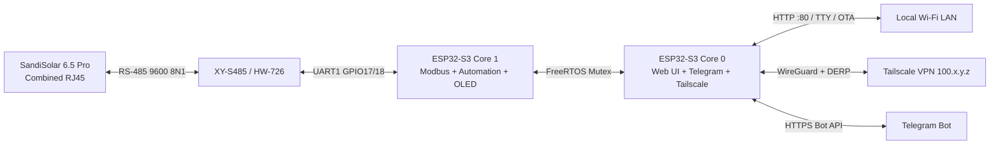

<p align="right">
  <b>🇬🇧 English</b> | <a href="README.uk.md">🇺🇦 Українська</a>
</p>

# ⚡ SandiSolar 6.5 Pro — ESP32-S3-N16R8 Standalone Controller

**Direct RS-485 Modbus RTU + Optional 1.3" OLED + Web Dashboard + Interactive Telegram Bot + Tailscale VPN & Remote TTY**

A fully autonomous, server-free controller and remote diagnostic gateway for the **SandiSolar 6.5 Pro (`Aohai AO-6KSL-G3` / `SD-PRO-EU 6.5K`)** hybrid solar inverter, built on **ESP32-S3-N16R8** (16 MB Flash, 8 MB Octal PSRAM).

> **100% Standalone (No MQTT, No Raspberry Pi / Home Assistant required):**  
> All telemetry polling, `SoftOFF / SoftON` grid-outage automation, LiFePO4 cold-weather charging protection, Web UI, Telegram bot, Tailscale WireGuard VPN, and remote CLI/TTY run directly on the dual-core **ESP32-S3-N16R8**.  
> Works both **with a 1.3" I2C OLED display (`SH1106` / `SSD1306`)** and **headless (without a display)** — OLED presence is auto-detected at boot.

---

## ✨ Key Features

* **Direct RS-485 Modbus RTU Master (`9600 8N1`, Slave ID `1`)** — polls ~45 Input & Holding registers every `3 s` with CRC-16 validation and instant `FC 0x06` writes (`Read-Modify-Write` for register `0` and system flags `201`).
* **Smart `SoftOFF / SoftON` Automation Engine:**
  * Configurable evaluation interval from **`5 s` to `600 s`** (default `60 s`) with **2× consecutive debounce** (minimum full debounce reaction: **`10 s`**).
  * **Grid Outage (`2× V_grid < 100 V`):** automatically sends **`SoftON` (`reg 0 = 1`)** + Telegram alert.
  * **Grid Present + `SOC ≥ 95%`:** switches inverter to **`SoftOFF` (`reg 0 = 0`, pure bypass)** to save idle power + Telegram alert.
  * **Grid Present + Inverter OFF + `SOC < 75%`:** automatically sends **`SoftON`** to recharge the battery from the grid.
  * **❄️ LiFePO4 Cold Protection (`T4 < 3.0 °C`):** blocks automated grid charging when battery is cold (resumes with hysteresis at `≥ 4.0 °C`).
  * **🪫 Low Battery Step Alerts:** one-shot Telegram alerts at `≤ 50%`, `40%`, `30%`, `20%`, `10%` (resets above `53%`).
  * **🛡️ Freeze State:** automatically freezes switching decisions if RS-485 communication is lost.
* **Modern 6-Tab Dark Web UI (Port `80`, Captive Portal, Web OTA `/update`):**
  * Live energy flow diagram, battery/BMS telemetry, inverter mode & register controls, automation event log, built-in **RS-485 Modbus Tester & HEX Packet Tracer**, Wi-Fi scanner in AP mode (`Sandisolar-S3-Setup` → `http://192.168.4.1`), and **Web OTA** firmware updates.
* **Two-Way Interactive Telegram Bot:**
  * Persistent 9-button keyboard (`Status`, `Battery + ETA`, `Grid`, `Solar`, `Load`, `Temperatures`, `Automation`, `SoftON`, `SoftOFF`).
  * Control & engineering commands: `/on`, `/off`, `/auto_on`, `/auto_off`, `/ac_curr <A>`, `/max_curr <A>`, `/soc_off <%>`, `/soc_on <%>`, `/log`, `/swap`, `/raw <fc> <addr> <cnt>`, `/trace_on`, `/trace_off`, `/reboot`.
* **Tailscale WireGuard VPN + Lightweight Remote Console (No Port Forwarding):**
  * Built-in `MicroLink` Tailscale client running in 8 MB PSRAM — direct access via `http://100.x.y.z/` from anywhere.
  * Supports an optional compile-time diagnostic key via git-ignored `include/secrets.h`, a user-provided custom Tailscale Auth Key in Web UI, or completely disabling Tailscale.
  * **Ultra-lightweight Remote CLI / TTY** for low-bandwidth DERP links:
    * Web TTY terminal: `http://<IP>/tty` (and `/lite`) + REST `/api/cli?cmd=...`
    * TCP / Telnet TTY (with live log streaming `watch on`): `nc <IP> 2323`
    * UDP CLI (instant single-packet commands): `nc -u <IP> 4444`

---

## 🔌 Hardware & Wiring (Pinout)

### ⚠️ CRITICAL NOTE for `YD-ESP32-23` / `ESP32-S3-N16R8` Boards (`IN-OUT` Jumper!)

On most **`YD-ESP32-23` (`ESP32-S3-WROOM-1 N16R8`)** dev boards, the **`IN-OUT`** solder jumper (located near pins `11–12`, next to the RGB LED) is **OPEN (unsoldered) from the factory**. When open, a protection diode isolates USB power from the `5Vin` pin, so **`5Vin` outputs only ~2.5 V (phantom voltage) instead of 5 V**, which will prevent RS-485 transceivers from working!

* **Option A (Recommended, no soldering — for black isolated `XY-S485` `TTL 3.3V/5V` module):**  
  Connect module `VCC` to one of the two **`3V3`** pins on the ESP32-S3.
* **Option B (For 5 V-only blue `HW-726` / `MAX485` module, or 5 V operation):**  
  Bridge the **`IN-OUT`** solder pad on the ESP32-S3 board so `5Vin` outputs solid `5.0 V` from USB-C. *(Warning: once bridged, never connect external 5 V to `5Vin` at the same time as USB-C!)*

### 1. ESP32-S3-N16R8 ↔ RS-485 Module (`XY-S485` or `HW-726`)

| RS-485 Module (TTL Side) | ESP32-S3-N16R8 Pin | Description |
| :--- | :--- | :--- |
| **`VCC`** | **`3V3`** *(for `XY-S485`)* or **`5Vin`** *(with `IN-OUT` bridged)* | Module power supply |
| **`GND`** | **`GND`** | Common ground |
| **`RXD`** | **`GPIO 17`** (`RX`) | UART Receive (from inverter into ESP32) |
| **`TXD`** | **`GPIO 18`** (`TX`) | UART Transmit (from ESP32 to inverter) |

### 2. RS-485 Module ↔ SandiSolar 6.5 Pro Combined `RJ45` Port

The **SandiSolar 6.5 Pro (`SD-PRO-EU 6.5K` / `AO-6KSL-G3`)** has a **single combined RJ45 communication port** carrying both **CAN** (for lithium battery BMS) and **RS-485** (Modbus RTU).

Holding a standard **T568B** RJ45 plug with **gold contacts facing you and cable pointing UP**, pin numbering runs **right-to-left (`1` → `8`)**:

| RJ45 Pin | T568B Wire Color | Inverter Signal | Connect To |
| :---: | :--- | :--- | :--- |
| **Pin 2** | 🟠 **Orange** | **`485-A` (+)** *(internally tied to Pin 7)* | RS-485 **`A+`** |
| **Pin 1** | 🟠⚪ **White-Orange** | **`485-B` (-)** *(internally tied to Pin 8)* | RS-485 **`B-`** |
| **Pin 3** | 🟢⚪ **White-Green** | **`GND`** *(internally tied to Pin 6)* | RS-485 **`GND`** |
| *Pin 4* | *🔵 Blue* | *`CAN-H`* | *Battery BMS CAN-H (do not wire to RS-485)* |
| *Pin 5* | *🔵⚪ White-Blue* | *`CAN-L`* | *Battery BMS CAN-L (do not wire to RS-485)* |

> **Inverter Menu Setting:** Go to `Settings` → `Battery Settings (2/3)` → set **`BMS communication mode`** to **`CAN`** (or `Disable` if no BMS is used). Do **not** set it to `485`, otherwise the inverter uses Pins 1–2 as a BMS Master instead of Modbus Slave.

### 3. ESP32-S3-N16R8 ↔ Optional 1.3" I2C OLED (`SH1106` / `SSD1306` 128×64)

| I2C OLED Pin | ESP32-S3-N16R8 Pin | Description |
| :--- | :--- | :--- |
| **`VCC`** | **`3V3`** | 3.3 V power |
| **`GND`** | **`GND`** | Ground |
| **`SDA`** | **`GPIO 8`** | I2C Data (`0x3C` / `0x3D`) |
| **`SCL`** | **`GPIO 9`** | I2C Clock (400 kHz) |

*(All GPIO pins `RX/TX/SDA/SCL` and OLED type `SH1106` / `SSD1306` can be changed live in the Web UI under **Settings & OTA** without reflashing.)*

---

## 📐 Dual-Core FreeRTOS Architecture



* **Core 1 (Realtime & Hardware):** `SandisolarModbus` (3 s poll cycle), `AutomationEngine` (5–600 s rule loop with 2× debounce), `OledDisplayManager` (3-page auto-rotating display, skipped automatically if absent).
* **Core 0 (Network & Remote Access):** `WebServerManager` (chunked HTTP serving, Captive Portal, Web OTA), `RemoteConsoleManager` (`/tty`, TCP `:2323`, UDP `:4444`), `TelegramBotManager` (dedicated 12 KB stack task), `MicroLink` Tailscale VPN (in 8 MB PSRAM).

---

## 🚀 Build, Flash & First Setup

### 1. Optional Local Secrets (Tailscale Auth Key)
Copy the template if you want to embed a private Tailscale Auth Key into your local build (this file is git-ignored and never committed):
```bash
cp include/secrets.h.example include/secrets.h
# Edit include/secrets.h and set BUILTIN_TAILSCALE_AUTH_KEY (or leave empty)
```
*(You can also configure or disable Tailscale at runtime in the Web UI without `secrets.h`.)*

### 2. Build with PlatformIO
```bash
pio run
```
This builds both:
* `.pio/build/esp32-s3-n16r8/firmware.factory.bin` — full image (`bootloader + partitions + boot_app0 + firmware`) for first-time USB flashing at **`0x0000`**.
* `.pio/build/esp32-s3-n16r8/firmware.bin` — application image for wireless **Web OTA** updates.

### 3. Initial USB Flash (`0x0000`)
```bash
pio run -t upload
```
Or using `esptool`:
```bash
esptool.py --chip esp32s3 -b 460800 write_flash 0x0 .pio/build/esp32-s3-n16r8/firmware.factory.bin
```

### 4. First-Time Wi-Fi Setup (Captive Portal)
1. Power on the ESP32-S3 — it creates an open Wi-Fi AP named **`Sandisolar-S3-Setup`**.
2. Connect and open **`http://192.168.4.1`**.
3. Open **Settings & OTA** → click **Scan Wi-Fi** → select your 2.4 GHz network, enter password, optionally configure Telegram / Tailscale, and click **Save**. The board automatically reboots into normal mode (`http://sandisolar.local`).

### 5. Wireless Updates (Web OTA)
Open `http://<LAN_IP>/` or `http://<TAILSCALE_IP>/` → **Settings & OTA** → upload `firmware.bin` → click **Flash OTA**.
