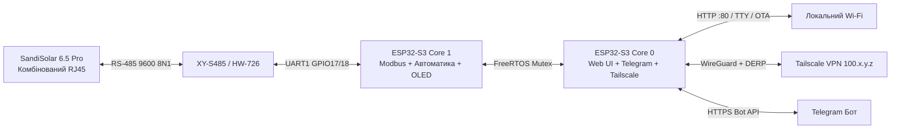

<p align="right">
  <a href="README.md">🇬🇧 English</a> | <b>🇺🇦 Українська</b>
</p>

# ⚡ SandiSolar 6.5 Pro — Автономний контролер на ESP32-S3-N16R8

**Прямий RS-485 Modbus RTU + Опціональний 1.3" OLED + Веб-дашборд + Інтерактивний Telegram-бот + Tailscale VPN та віддалена TTY-консоль**

Повністю автономний контролер і діагностичний шлюз для гібридного сонячного інвертора **SandiSolar 6.5 Pro (`Aohai AO-6KSL-G3` / `SD-PRO-EU 6.5K`)** на базі мікроконтролера **ESP32-S3-N16R8** (16 MB Flash, 8 MB Octal PSRAM).

> **100% Автономність (без MQTT, без сервера та без Home Assistant):**  
> Усе опитування інвертора, автоматика `SoftOFF / SoftON`, зимовий захист LiFePO4, веб-інтерфейс, Telegram-бот, Tailscale WireGuard VPN та віддалена консоль працюють безпосередньо всередині двоядерного **ESP32-S3-N16R8**.  
> Підтримується робота як **з 1.3" I2C OLED-екраном (`SH1106` / `SSD1306`)**, так і **без екрана (headless)** — наявність дисплея визначається автоматично при старті.

---

## ✨ Основні можливості

* **Прямий RS-485 Modbus RTU Master (`9600 8N1`, Slave ID `1`)** — опитує ~45 Input та Holding регістрів кожні `3 с` із перевіркою `CRC-16` та миттєвим записом `FC 0x06` (`Read-Modify-Write` для регістра `0` і прапорців `201`).
* **Розумна автоматика `SoftOFF / SoftON`:**
  * Інтервал оцінки правил налаштовується від **`5 с` до `600 с`** (за замовчуванням `60 с`) із **2× дебаунсом** (мінімальний повний час реакції дебаунсу: **`10 с`**).
  * **`2× СВІТЛА НЕМАЄ` (`V_grid < 100 В`):** автоматичний запуск генерації **`SoftON` (`reg 0 = 1`)** + сповіщення в Telegram.
  * **`2× СВІТЛО Є` + `SOC ≥ 95%`:** переведення інвертора у **`SoftOFF` (`reg 0 = 0`, чистий байпас)** для економії власного споживання + сповіщення в Telegram.
  * **`2× СВІТЛО Є` + Інвертор `OFF` + `SOC < 75%`:** автоматичний запуск **`SoftON`** для дозарядки АКБ від мережі.
  * **❄️ Зимовий захист LiFePO4 (`T4 < 3.0 °C`):** блокує автоматичний заряд від мережі при холодній батареї (відновлення з гістерезисом при `≥ 4.0 °C`).
  * **🪫 Драбинка сповіщень про розряд АКБ:** одноразові сповіщення при досягненні `≤ 50%`, `40%`, `30%`, `20%`, `10%` (скидання при `> 53%`).
  * **🛡️ Freeze State:** блокує хибні перемикання при втраті зв'язку RS-485.
* **6-вкладковий темний Веб-інтерфейс (порт `80`, Captive Portal, Web OTA `/update`):**
  * Динамічна схема енергетичних потоків, телеметрія батареї/BMS, керування режимами та регістрами, журнал подій автоматики, вбудований **RS-485 Modbus тестер і HEX-трейсер**, сканер Wi-Fi в режимі точки доступу (`Sandisolar-S3-Setup` → `http://192.168.4.1`) та **Web OTA** оновлення.
* **Двосторонній інтерактивний Telegram-бот:**
  * Постійна клавіатура на 9 кнопок (`Загальний статус`, `Батарея + ETA`, `Мережа`, `Сонце`, `Споживання`, `Температури`, `Автоматика`, `SoftON`, `SoftOFF`).
  * Команди керування та інженерної діагностики: `/on`, `/off`, `/auto_on`, `/auto_off`, `/ac_curr <A>`, `/max_curr <A>`, `/soc_off <%>`, `/soc_on <%>`, `/log`, `/swap`, `/raw <fc> <addr> <cnt>`, `/trace_on`, `/trace_off`, `/reboot`.
* **Tailscale WireGuard VPN + легка віддалена консоль (без прокидання портів):**
  * Вбудований клієнт `MicroLink` (у 8 МБ PSRAM) — прямий доступ із будь-якої точки світу за адресою `http://100.x.y.z/`.
  * Підтримує опціональний вшитий ключ через git-ignored `include/secrets.h`, введення власного ключа користувача у Web UI або повне вимкнення служби.
  * **Надлегка інженерна консоль** (працює навіть через повільний DERP):
    * Веб-термінал: `http://<IP>/tty` (та `/lite`) + REST `/api/cli?cmd=...`
    * TCP / Telnet TTY (із живим потоком логів `watch on`): `nc <IP> 2323`
    * UDP CLI (миттєві однопакетні команди): `nc -u <IP> 4444`

---

## 🔌 Схема підключення компонентів (Pinout)

### ⚠️ КРИТИЧНО ВАЖЛИВО для плат `YD-ESP32-23` / `ESP32-S3-N16R8` (перемичка `IN-OUT`!)

На більшості плат **`YD-ESP32-23` (`ESP32-S3-WROOM-1 N16R8`)** перемичка **`IN-OUT`** (дві сріблясті площадки біля пінів `11–12`, поруч зі світлодіодом `RGB`) із заводу **РОЗІМКНУТА (не запаяна)**. У такому стані захисний діод відсікає живлення USB від піна `5Vin`, і на **`5Vin` замість 5 В висять лише фантомні ~2.5 В**, через що модулі RS-485 не запускаються!

* **Варіант А (Рекомендовано, без паяльника — для чорного ізольованого модуля `XY-S485` `TTL 3.3V/5V`):**  
  Підключіть `VCC` модуля на один із двох пінів **`3V3`** плати ESP32-S3.
* **Варіант Б (Для 5-вольтового синього модуля `HW-726` / `MAX485` або живлення від 5 В):**  
  Замкніть краплею припою перемичку **`IN-OUT`** на платі ESP32-S3 — тоді на піні `5Vin` з'являться стабільні `5.0 В` від USB-C. *(Увага: після запаювання `IN-OUT` ніколи не подавайте зовнішні 5 В на `5Vin` одночасно з USB-кабелем!)*

### 1. ESP32-S3-N16R8 ↔ Модуль RS-485 (`XY-S485` або `HW-726`)

| Контакт модуля RS-485 (TTL) | Пін `ESP32-S3-N16R8` | Призначення |
| :--- | :--- | :--- |
| **`VCC`** | **`3V3`** *(для `XY-S485`)* або **`5Vin`** *(із запаяним `IN-OUT`)* | Живлення модуля |
| **`GND`** | **`GND`** | Спільна земля |
| **`RXD`** | **`GPIO 17`** (`RX`) | Прийом даних від інвертора в ESP32 |
| **`TXD`** | **`GPIO 18`** (`TX`) | Передача запитів від ESP32 в інвертор |

### 2. Модуль RS-485 ↔ Комбінований порт `RJ45` інвертора SandiSolar 6.5 Pro

Інвертор **SandiSolar 6.5 Pro (`SD-PRO-EU 6.5K` / `AO-6KSL-G3`)** має **один комбінований роз'єм RJ45**, на якому одночасно виведені шини **CAN** (для BMS батареї) та **RS-485** (Modbus RTU).

Якщо тримати стандартний штекер **RJ45 (T568B)** **золотими контактами до себе, кабелем ВГОРУ**, нумерація пінів іде **справа наліво (`1` → `8`)**:

| Пін RJ45 | Колір жили (T568B) | Сигнал інвертора | Куди підключати |
| :---: | :--- | :--- | :--- |
| **Pin 2** | 🟠 **Помаранчевий** | **`485-A` (+)** *(запаралелений на платі з Pin 7)* | Клема **`A+`** |
| **Pin 1** | 🟠⚪ **Біло-помаранчевий** | **`485-B` (-)** *(запаралелений на платі з Pin 8)* | Клема **`B-`** |
| **Pin 3** | 🟢⚪ **Біло-зелений** | **`GND`** *(запаралелений на платі з Pin 6)* | Клема **`GND`** |
| *Pin 4* | *🔵 Синій* | *`CAN-H`* | *CAN-H батареї BMS (до RS-485 не підключати)* |
| *Pin 5* | *🔵⚪ Біло-синій* | *`CAN-L`* | *CAN-L батареї BMS (до RS-485 не підключати)* |

> **Налаштування в меню інвертора:** `Settings` → `Battery Settings (2/3)` → **`BMS communication mode`** має бути **`CAN`** (або `Disable`, якщо батарея без BMS). Не ставте `485`, інакше інвертор переведе піни 1–2 у режим опитування батареї (Master) замість Modbus Slave.

### 3. ESP32-S3-N16R8 ↔ Опціональний 1.3" I2C OLED (`SH1106` / `SSD1306` 128×64)

| Контакт `I2C OLED` | Пін `ESP32-S3-N16R8` | Призначення |
| :--- | :--- | :--- |
| **`VCC`** | **`3V3`** | Живлення 3.3 В |
| **`GND`** | **`GND`** | Спільна земля |
| **`SDA`** | **`GPIO 8`** | Лінія даних I2C (`0x3C` / `0x3D`) |
| **`SCL`** | **`GPIO 9`** | Тактова лінія I2C (400 кГц) |

*(Усі піни `RX/TX/SDA/SCL` та тип контролера дисплея `SH1106` / `SSD1306` можна змінити у вкладці **Налаштування та OTA** без перепрошивки).*

---

## 📐 Архітектура FreeRTOS (Два ядра ESP32-S3)



* **Ядро 1 (`Core 1`):** `SandisolarModbus` (опитування кожні 3 с), `AutomationEngine` (цикл 5–600 с із 2× дебаунсом), `OledDisplayManager` (ротація 3 екранів; автоматично вимикається, якщо дисплей не підключено).
* **Ядро 0 (`Core 0`):** `WebServerManager` (HTTP-сервер із чанковою віддачею, Captive Portal, Web OTA), `RemoteConsoleManager` (`/tty`, TCP `:2323`, UDP `:4444`), `TelegramBotManager` (окрема задача зі стеком 12 КБ), `MicroLink` Tailscale VPN (у 8 МБ PSRAM).

---

## 🚀 Збірка, прошивка та перший запуск

### 1. Опціональні локальні секрети (Tailscale Auth Key)
Якщо хочете вшити власний ключ Tailscale у локальний білд (файл у `.gitignore` і ніколи не потрапляє на GitHub):
```bash
cp include/secrets.h.example include/secrets.h
# Вкажіть BUILTIN_TAILSCALE_AUTH_KEY у include/secrets.h (або залиште порожнім)
```
*(Також ключ Tailscale можна вводити або повністю вимикати службу безпосередньо у веб-інтерфейсі).*

### 2. Компіляція через PlatformIO
```bash
pio run
```
Автоматично створюються два файли:
* `.pio/build/esp32-s3-n16r8/firmware.factory.bin` — повний образ (`bootloader + partitions + boot_app0 + firmware`) для первинної прошивки по USB з адреси **`0x0000`**.
* `.pio/build/esp32-s3-n16r8/firmware.bin` — образ для бездротового оновлення через **Web OTA**.

### 3. Первинна прошивка по USB Type-C (`0x0000`)
```bash
pio run -t upload
```
Або через `esptool`:
```bash
esptool.py --chip esp32s3 -b 460800 write_flash 0x0 .pio/build/esp32-s3-n16r8/firmware.factory.bin
```

### 4. Перший запуск і налаштування Wi-Fi
1. Подайте живлення на ESP32-S3 — плата створить відкриту мережу **`Sandisolar-S3-Setup`**.
2. Підключіться до неї та відкрийте **`http://192.168.4.1`**.
3. Перейдіть у **Налаштування та OTA** → натисніть **Сканувати Wi-Fi** → оберіть вашу мережу 2.4 ГГц, введіть пароль, за потреби налаштуйте Telegram / Tailscale і натисніть **Зберегти**. Плата автоматично перезавантажиться (`http://sandisolar.local`).

### 5. Бездротове оновлення (Web OTA)
Відкрийте `http://<LAN_IP>/` або `http://<TAILSCALE_IP>/` → **Налаштування та OTA** → оберіть `firmware.bin` → натисніть **Прошити OTA**.
